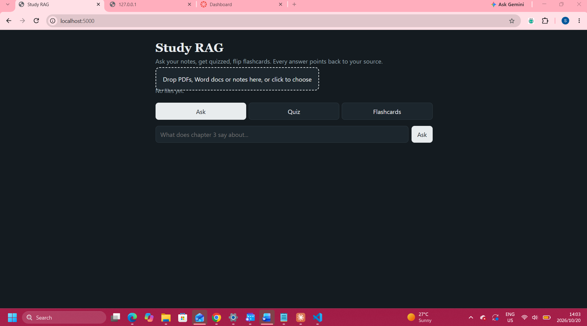

# Study RAG

A small web app that turns your own study materials into a study partner. Upload PDFs, Word documents or text notes, then ask questions and get answers with citations, take multiple-choice quizzes, or flip through flashcards, all generated from your own material.



## Features

- **Ask with citations:** answers use only your uploaded material, with numbered sources pointing to the file and page or heading they came from.
- **Quiz mode:** generates multiple-choice questions with instant feedback, explanations and a running score. Optionally focus on a topic.
- **Flashcards:** flip cards generated from your material, again with an optional topic.
- **Mixed formats:** PDF (per page), Word `.docx` (per heading section), `.txt` and `.md`.
- **Saved index:** you upload once, and the index is stored on disk for next time.

## How it works

This is a Retrieval-Augmented Generation (RAG) pipeline:

1. **Ingest:** extract text from each file, then split it into chunks of about 180 words with a 30-word overlap, so ideas are not cut in half.
2. **Embed:** each chunk is converted to a vector with the local `all-MiniLM-L6-v2` model (sentence-transformers). The vectors are saved to `data/index.pkl`.
3. **Retrieve:** the question is embedded the same way, and the 6 chunks with the highest cosine similarity are selected (NumPy).
4. **Generate:** the chunks are passed to Google Gemini as numbered sources. The prompt tells the model to answer only from them, cite them as [1], [2], and say so if they do not cover the question.

Quizzes and flashcards reuse the same retrieval, then ask the model for structured JSON that the page turns into interactive cards.

**Stack:** Python, Flask, pypdf, python-docx, sentence-transformers, NumPy, Google Gemini API (`google-genai`), plain HTML/CSS/JavaScript front end.

## Run it locally

You need Python 3.9+ and a free Gemini API key from https://aistudio.google.com/apikey.

```
python -m venv .venv
.venv\Scripts\activate          # Mac/Linux: source .venv/bin/activate
pip install -r requirements.txt
$env:GEMINI_API_KEY="your-key"  # Mac/Linux: export GEMINI_API_KEY=your-key
python app.py
```

Open http://127.0.0.1:5057 and upload your files. The first start downloads the embedding model (about 90 MB).

To use a different model, set `GEMINI_MODEL` before starting the app.

**PowerShell blocks activation?** Run `Set-ExecutionPolicy -Scope Process RemoteSigned` first.

## Limitations

- Scanned PDFs without a text layer are not supported (they need OCR first).
- Tables, charts and diagrams are not understood, only extracted text.
- The index is one global in-memory store with no user accounts or login, so this is built for personal use, not public hosting.
- Quiz and flashcard output depends on the model returning valid JSON; occasionally a retry is needed.
- Retrieval quality has not been formally evaluated yet.
- Retrieved text is sent to the Gemini API. Free-tier data may be used by Google to improve its products, so avoid sensitive material.

## Ideas for next steps

- Evaluate retrieval with a small set of test questions (recall@k).
- Hybrid search (keyword plus vectors) and reranking.
- OCR for scanned documents.
- Authentication and per-user indexes so it can be hosted safely.
- Structured-output mode for more reliable quizzes.

## What I learned

- How RAG fits together end to end: chunking, embeddings, similarity search and prompt design that keeps answers grounded in sources.
- Handling real API failures: a retired model name (404), temporary overload (503) and rate limits (429), with readable error messages and automatic retries.
- Keeping secrets out of code by using environment variables, and keeping personal data out of version control with `.gitignore`.
- Debugging methodically: a stale copy of the server was still answering on the same port, so I changed the port and made the front end show the server's real response.

## Project structure

```
app.py             Flask server, ingestion, retrieval, generation and the web page
requirements.txt   Python dependencies
data/              Saved index (created on first upload, not committed)
```
